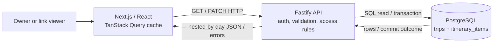

# TripSync Itinerary Service — Architecture v1

**Status:** Design exercise, not an implemented-system guarantee.  
**Scope:** One itinerary per trip; Next.js frontend, Fastify API, PostgreSQL database.

## Users and assumptions

- The **trip owner** can manage activities. **Anyone with an active sharing link** can view the itinerary, but cannot edit; the owner can disable sharing.
- An itinerary is organized by day; activities have a title, optional time, location, notes, and a **position** within the day.
- Expected: **100,000 registered users**, **10,000 daily active users**, and **5 trips per registered user on average**. No hard trip limit.
- Real-time collaboration and offline editing are out of scope. Changes auto-save while online; only acknowledged saves are guaranteed to persist.

## Functional requirements

1. **Manage itinerary:** Create, read, update, delete, and reorder activities organized by day.
2. **Auto-save:** Persist successfully saved edits and show saving/error status to the owner.
3. **Read-only sharing:** Enable/disable a shareable link; enforce owner-only editing on the backend.

## Non-functional requirements

1. **Read latency:** Target p95 itinerary load within **1 second** under agreed load.
2. **Save latency:** Target p95 acknowledged save within **2 seconds** under agreed load.
3. **Availability:** Aim for **99.9% monthly uptime**; maintain data integrity for accepted writes.

## Capacity estimate (assumptions, not measurements)

- 10,000 daily active users × **5 reads/day** = **50,000 reads/day** ≈ **0.58 average read RPS**.
- 10,000 daily active users × **10 writes/day** = **100,000 writes/day** ≈ **1.16 average write RPS**.
- Traffic is uneven: actual **peak RPS is unknown** and needs testing. These are assumed backend request counts, not page views or individual keystrokes.

## API sketch

| Action | Proposed endpoint | Body / response |
|---|---|---|
| Read itinerary | `GET /api/itineraries/:itineraryId` | `200` with trip name and `days: [{ date, activities: [{ id, title, position, time?, location?, notes? }] }]` |
| Create activity | `POST /api/activities` | `{ trip_id, title, date, time?, location?, notes? }`; server may assign next `position` |
| Edit activity | `PATCH /api/activities/:activityId` | Only changed fields, e.g. `{ "title": "Tokyo Tower at sunset" }` |
| Delete activity | `DELETE /api/activities/:activityId` | Delete the selected activity |
| Reorder within a day | `PATCH /api/itineraries/:itineraryId/activities/order` | `{ "date": "2027-10-10", "activities": [{ "id": 3, "position": 1 }, { "id": 1, "position": 2 }, { "id": 2, "position": 3 }] }` |

**API-ID decision pending implementation:** Earlier API exercises use `:itineraryId`, but the existing PostgreSQL exercise links `itinerary_items.trip_id` to `trips.id`. With one itinerary per trip, prefer resolving the API to a **trip ID** (for example, `GET /api/trips/:tripId/itinerary`) before coding, and revise the previous API specification consistently. Do not assume an `itineraries` table exists.

**Errors and security:** Missing resource → `404` with `{ "code": "ITINERARY_NOT_FOUND", "message": "Itinerary not found" }`. Invalid or missing authentication on private endpoints → `401`; an authenticated user attempting a forbidden edit → `403` (or deliberately `404` to avoid exposing private resource existence). Sharing links should use unguessable tokens and only permit reads. Validate that every activity belongs to the target trip/day.

## High-level design and read/write data flow

- **Read:** TanStack Query requests itinerary → Fastify checks visibility → PostgreSQL returns trip/items → Fastify groups activities by day and sorts by `position` → browser renders and caches response.
- **Write/reorder:** Owner sends edits → Fastify verifies ownership, validates dates/positions and item membership → PostgreSQL applies all related position updates in **one transaction** → Fastify acknowledges success → frontend invalidates/updates its cached itinerary. If one update fails, **roll back all** reorder changes.
- **Data design to verify:** Existing `trips` and `itinerary_items` with foreign key `trip_id`; confirm activity date and position fields, and ownership/sharing fields in the real schema before implementation. An index starting with `trip_id` can help itinerary lookups; assess it using query plans.

## Main tradeoffs and bottlenecks

- **Nested day response:** Easy for day-based UI and reordering, but API must transform database rows; avoid assuming nested JSON means a nested database schema.
- **Client caching:** Reduces duplicate fetches, but edits require invalidation/update to avoid stale views. Shared-link revocation must also be enforced server-side, even if a viewer still has cached content.
- **Single Fastify + PostgreSQL for v1:** Simple to build and operate at assumed average traffic. Monitor API latency, database query time, connection saturation, and browser rendering before adding cache servers, replicas, or load balancers.
- **Reorder transaction:** Protects data consistency but may require coordination for concurrent owner edits; version checks or conflict handling can be added if needed.
- **Testing:** First measure where latency occurs, then load-test representative read/write mixes in a safe environment (including peak bursts), rather than treating 1,000 concurrent requests as a proven requirement.

## Tradeoff review and failure scenarios (November 17 exercise)

### Two tradeoffs ###
1. **Nested-by-day response vs. flat activity array (daily itinerary UI).** Nested JSON matches the day-by-day React view, so the frontend does less grouping. The cost is deeper object traversal and more complex immutable updates; a flat array is simpler for generic activity manipulation but requires grouping by date for the daily view. Decision: Keep the nested-by-day GET response for v1.
2. **Nested vs. flat response (trip-wide search).** With a flat array already loaded in the browser, filtering all activities is straightforward. With nested JSON, the client must traverse each day or flatten the activities first. Tradeoff nuance: This concerns client-side searching over a fetched response; backend search can query flat relational activity rows directly, regardless of how the GET response is shaped. Decision: Keep nested GET for the current day-based UI and introduce a dedicated search endpoint only if product needs warrant it.
**Ordering justification:** Give each activity a stable id and an explicit position scoped to its day. Array indexes describe the current array layout, but are not persistent database ordering keys: a deletion, insertion, or new response can shift indexes. Sort by position when reading; validate a complete reorder payload and save all affected positions atomically. If v1 requires consecutive positions, renumber after deletion within a transaction.

**Two API failure scenarios
1. **Missing itinerary:** GET /api/itineraries/:itineraryId for a well-formed nonexistent ID returns 404 Not Found with { "code": "ITINERARY_NOT_FOUND", "message": "Itinerary not found" }. Use a resource-specific error code so the UI can distinguish missing itineraries from other errors.
2. **Database failure halfway through reorder:** PATCH /api/itineraries/:itineraryId/activities/order applies the changes in a database transaction. If an update fails unexpectedly, ROLLBACK all affected position changes and return 500 Internal Server Error, for example { "code": "REORDER_FAILED", "message": "Could not save activity order" }. The frontend should show an error and revert or refetch any optimistic ordering. Do not leave a partially saved order.

## Next validation steps ##
Confirm actual schema and canonical IDs; implement authorization, CRUD and reorder; run an end-to-end test for missing itinerary (404), shared viewer write rejection (403), rollback on partial reorder failure, and post-save cache refresh. Review p95 performance and availability targets after measuring a working system.