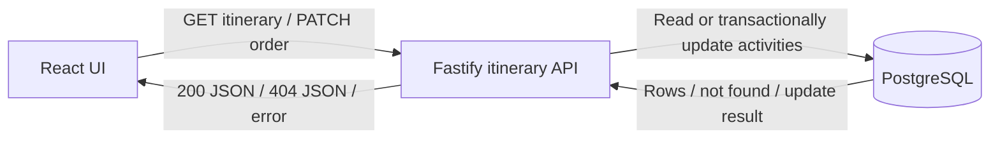

# TripSync — Itinerary API Specification (v1)

**Scope:** Read a trip itinerary and reorder activities within one day. One itinerary belongs to one trip. Only an authorized owner can edit; shared viewers have read-only access. The example assumes activity IDs are integers; adjust the ID type to match the database schema.

## 1. Get itinerary by ID

`GET /api/itineraries/{itineraryId}`

**200 OK** — return the itinerary grouped by day. Each day's activities are sorted by `position` ascending.

```json
{
  "id": "5b41cc3f-8397-4c29-b42e-c3b5a6b79f68",
  "title": "Japan 2027",
  "days": [
    {
      "date": "2027-10-10",
      "activities": [
        { "id": 1, "title": "Museum", "position": 1, "time": "09:00", "location": "Tokyo", "notes": null },
        { "id": 2, "title": "Shopping", "position": 2, "time": null, "location": null, "notes": null },
        { "id": 3, "title": "Dinner", "position": 3, "time": "19:00", "location": null, "notes": null }
      ]
    }
  ]
}
```

**404 Not Found** — a *well-formed* itinerary ID does not exist:

```json
{ "code": "ITINERARY_NOT_FOUND", "message": "Itinerary not found" }
```

Malformed IDs can return `400 Bad Request`. Authentication and authorization failures are handled separately (`401`/`403`, or `404` if the product deliberately hides resource existence).

## 2. Reorder activities within a day

`PATCH /api/itineraries/{itineraryId}/activities/order`

**Request** — provide the complete, intended order for one day (not just the moved activity):

```json
{
  "date": "2027-10-10",
  "activities": [
    { "id": 3, "position": 1 },
    { "id": 1, "position": 2 },
    { "id": 2, "position": 3 }
  ]
}
```

**200 OK** — return the saved order:

```json
{
  "date": "2027-10-10",
  "activities": [
    { "id": 3, "position": 1 },
    { "id": 1, "position": 2 },
    { "id": 2, "position": 3 }
  ]
}
```

**Validation:** The itinerary and day must exist; every submitted activity must belong to that day and itinerary; IDs must be unique, cover all activities in the day, and positions must be unique consecutive integers starting at 1. Reject invalid payloads with `400 Bad Request` (or `409 Conflict` for an order conflict if conflict detection is introduced). A missing itinerary returns the same `404` response as above.

**Atomicity:** Save all position changes in a single database transaction. If any update fails, roll back *all* changes; never persist a half-reordered day. If a unique `(day, position)` constraint exists, the implementation must avoid transient collisions during the swap.

## 3. Small data-flow diagram



## Decisions and tradeoffs

- **Nested-by-day GET response:** convenient for the itinerary UI; requires grouping rows on the backend.
- **Explicit `position` per activity:** preserves order after refresh; reordering often modifies multiple records.
- **Full-day reorder payload:** unambiguous final order, at the cost of a larger request than a single-move instruction.
